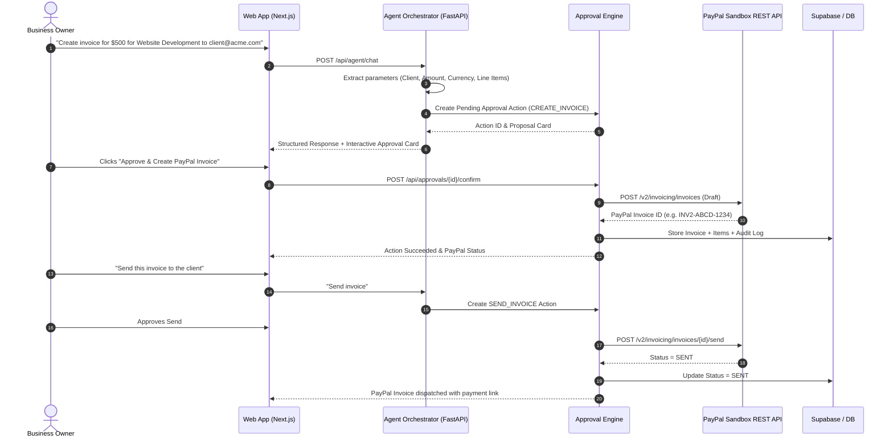
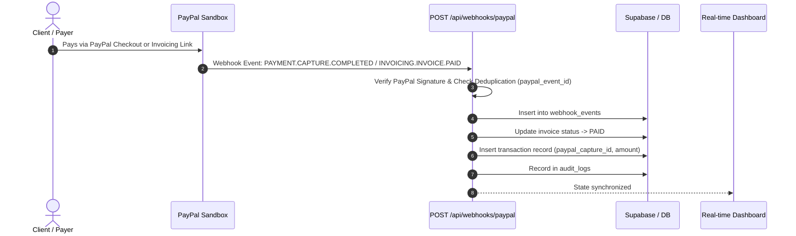

# PayPilot — System Architecture

**Hackathon:** PayPal AI Hackathon 2026  
**Product:** PayPilot — The AI Financial Operations Copilot for Independent Businesses  

---

## 1. Architectural Overview

PayPilot is architected around an **approval-based agentic workflow** where artificial intelligence assists, extracts, drafts, and analyzes financial operations, while human oversight strictly gates every external financial execution (e.g. creating PayPal invoices, sending invoices, creating checkout orders, dispatching overdue reminders).

```
┌────────────────────────────────────────────────────────────────────────┐
│                        PayPilot Web Application                        │
│             (Next.js App Router, Tailwind CSS, Lucide, Recharts)        │
│                                                                        │
│  ┌──────────────────┐  ┌───────────────────┐  ┌─────────────────────┐  │
│  │ Monef Dashboard  │  │ AI Copilot Drawer │  │ Invoices & Payments │  │
│  │  Metrics & Graph │  │  Approval Cards   │  │ PayPal Checkout UIs │  │
│  └────────┬─────────┘  └─────────┬─────────┘  └──────────┬──────────┘  │
└───────────┼──────────────────────┼───────────────────────┼─────────────┘
            │                      │                       │
            ▼                      ▼                       ▼
┌────────────────────────────────────────────────────────────────────────┐
│                        FastAPI Backend Engine                          │
│                                                                        │
│  ┌──────────────────┐  ┌───────────────────┐  ┌─────────────────────┐  │
│  │ REST Endpoints   │  │ Financial Agent   │  │ Approval Engine     │  │
│  │ /api/dashboard   │  │ Tool Calling Loop │  │ Action Authorization│  │
│  │ /api/invoices    │  │ Intent Extraction │  │ Idempotency Checks  │  │
│  └────────┬─────────┘  └─────────┬─────────┘  └──────────┬──────────┘  │
│           │                      │                       │             │
│           ▼                      ▼                       ▼             │
│  ┌──────────────────────────────────────────────────────────────────┐  │
│  │                       Services & Security                        │  │
│  │ Audit Logger · Analytics Engine · Currency Decimal Math · PDFs   │  │
│  └──────────────────────────────────────────────────────────────────┘  │
└───────────────────────────┬────────────────────────────────────────────┘
                            │
            ┌───────────────┴───────────────┐
            ▼                               ▼
┌───────────────────────────────┐  ┌─────────────────────────────────────┐
│    PayPal Developer REST      │  │        Supabase / PostgreSQL        │
│  ┌─────────────────────────┐  │  │  ┌────────────────────────────────┐ │
│  │ Invoicing API v2        │  │  │  │ profiles · customers           │ │
│  │ Orders API v2           │  │  │  │ invoices · invoice_items       │ │
│  │ Webhooks Engine         │  │  │  │ transactions · audit_logs      │ │
│  │ OAuth2 Token Cache      │  │  │  │ approvals · ai_sessions        │ │
│  └─────────────────────────┘  │  │  └────────────────────────────────┘ │
└───────────────────────────────┘  └─────────────────────────────────────┘
```

---

## 2. Core Agentic Workflow & Tool Calling Loop

Traditional chatbots merely output conversational text. PayPilot turns instructions into atomic, verifiable financial operations:



---

## 3. Webhook Synchronization & Payment Capture



---

## 4. Key Differentiators

1. **Approval-First Safety**: AI never transacts autonomously. Financial writes generate an approval card containing exact numbers and parameters for explicit merchant confirmation.
2. **Double-Entry Traceability**: Every operation generates an audit log record linking the user prompt, AI decision, human confirmation, PayPal API transaction ID, and database state.
3. **Resilient Dual-Mode Integration**: Operates seamlessly against the live PayPal Sandbox REST API, with intelligent self-contained simulation fallbacks for offline testing and reviewer evaluations.
4. **Calculated Financial Truth**: Financial insights, revenue calculations, and overdue reminders are computed with exact decimal math from database transactions—never hallucinated by an LLM.
